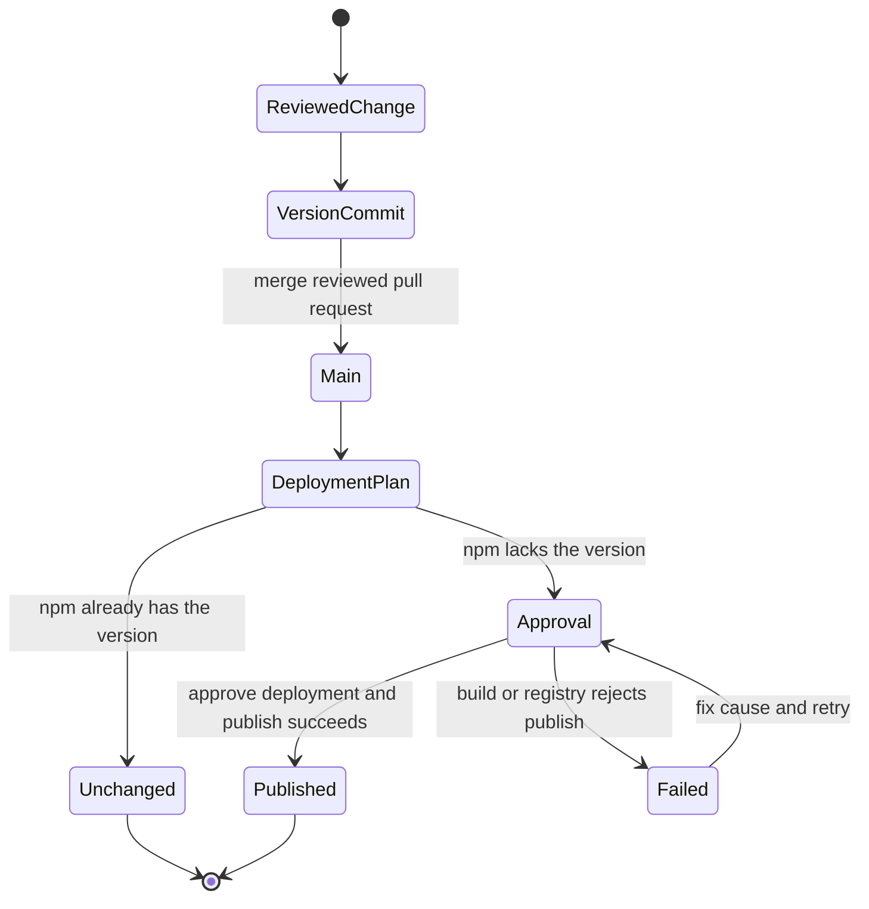

# Toolkit

NextNode's published npm packages live here. Shared development standards, libraries and brand assets belong here. GitHub Actions checks and deployment belong to [infrastructure](https://github.com/NextNodeSolutions/infrastructure).

## Start

Use the Node requirement and exact pnpm version declared in the root `package.json`.

```sh
pnpm install --frozen-lockfile
pnpm build
```

Read [AGENTS.md](AGENTS.md) before changing a package or adding one. It gives the local checks and package conventions.

## Release a package



1. Include the intended stable version in the package's `package.json` and describe its user-facing changes in that package's `CHANGELOG.md`. Review the version and changelog together with the code. Do not change another package's version without a reason.
2. Pass the checks and merge the version commit into `main`. The deployment plan compares each affected package's version with npm. Keeping an existing version publishes nothing.
3. Review and merge the standing `main` to `deployments` pull request. Approve the deployment when GitHub requests it. The infrastructure pipeline builds, packs and publishes the selected package.
4. Verify the registry version and install the published package before calling the release complete. Add a Git tag or GitHub release only after that verification, pointing to the published commit.

Version and changelog changes are ordinary reviewed commits. This keeps `package.json` as the only version source and avoids a second release runner. The pipeline does not create version commits, changelogs, tags or GitHub releases. A failed publish leaves the version commit merged but does not establish that npm accepted the version. Inspect npm before retrying, since other packages may already have published.

Packages publish independently and deployment entries run in parallel. If a change raises a runtime dependency or peer minimum to a new toolkit version, publish and verify that prerequisite in a separate deployment first. Then merge the dependent's version change. Development-only workspace links do not impose release ordering.

Use stable versions only. The pipeline publishes to `latest`, so a prerelease version would replace the stable dist-tag.

### First deployment and npm access

Follow [npm publisher setup](docs/npm-publishing.md) before authorizing any existing package's first toolkit release. The scope owner changes npm trust. No publish runs from a developer machine.

The migration pull request cannot create the standing deployment pull request because its base repository has only the initial commit. After it merges, the next human-opened pull request into `main` lets the pipeline create `deployments` and the standing pull request. The first deployment requires an approval.

Keep publishing blocked until infrastructure's canary has proved npm accepts the workflow identity and the scope owner has authorized the package's toolkit publisher. Tokenless publishing is a release gate to verify, not an assumed guarantee. Check infrastructure's provenance behavior before approving a release that would lose an existing npm attestation.
